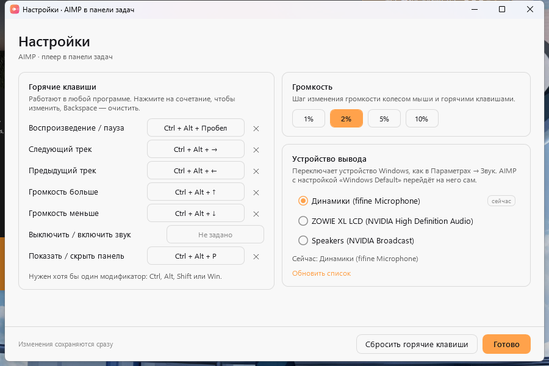
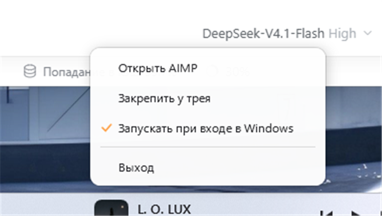

# AIMP · плеер в панели задач

Компактный плеер, встроенный в панель задач Windows: обложка, название трека, исполнитель,
текущее время и длительность, полоса прогресса и кнопки ⏮ ⏯ ⏭ — прямо на панели задач,
без отдельного окна и без открытия AIMP.







## Скачать

Готовый архив: **[AimpTaskbarPlayer-1.1-win-x64.zip](https://github.com/Whyhatend/aimp-taskbar-player/releases/latest)** —
распаковать и запустить `install.ps1`.

## Что умеет

- **Обложка** — встроенная в теги картинка (ID3/FLAC/MP4/Vorbis), иначе `cover.jpg`/`folder.jpg` из папки трека, иначе аккуратная заглушка.
- **Название, исполнитель, время** — `0:42 / 3:15`, обновляется 4 раза в секунду; длинные строки обрезаются, полные данные — в подсказке при наведении (альбом, год, жанр, битрейт, формат, путь к файлу).
- **Управление** — ⏮ / ⏯ / ⏭ и перемотка кликом или протяжкой по полосе прогресса.
- **Громкость колесом** — прокрутка над панелью меняет громкость AIMP; справа на секунду появляется индикатор `98%`. Шаг (1/2/5/10%) настраивается.
- **Горячие клавиши** — глобальные сочетания для паузы, переключения треков, громкости, mute и показа панели. Работают в любой программе и даже когда панель скрыта.
- **Окно настроек** — горячие клавиши, шаг громкости и устройство вывода Windows в одном месте; изменения сохраняются сразу.
- **Двойной клик** — пауза/воспроизведение. Открыть окно AIMP — правый клик → «Открыть AIMP» (окно поднимается на передний план, даже если AIMP свёрнут в трей).
- **Перетаскивание** — панель двигается вдоль панели задач и запоминает место; «Закрепить у трея» возвращает её к правому краю.
- **Тема** — автоматически светлая или тёмная, как в Windows: подстраиваются текст, иконки, полоса и обложка-заглушка.
- **Автозапуск** с Windows (включается в меню, установщик включает по умолчанию).
- **Не мешает** — не показывается в Alt+Tab, не забирает фокус у активного окна, прячется вместе с панелью задач и в полноэкранных приложениях.
- **Иконка в трее** — показать панель, настройки, автозапуск, выход.

## Настройки

Правый клик по панели → «Настройки…» или меню иконки в трее. Окно не мешает панели:
его можно открыть и при скрытой панели. Изменения сохраняются сразу, кнопка «Готово» просто закрывает окно.

### Горячие клавиши

| Действие | По умолчанию |
| --- | --- |
| Воспроизведение / пауза | `Ctrl + Alt + Space` |
| Следующий трек | `Ctrl + Alt + →` |
| Предыдущий трек | `Ctrl + Alt + ←` |
| Громкость больше | `Ctrl + Alt + ↑` |
| Громкость меньше | `Ctrl + Alt + ↓` |
| Показать / скрыть панель | `Ctrl + Alt + P` |
| Выключить / включить звук | не задано |

- Нажмите на сочетание и введите новое. `Backspace`/`Delete` — очистить, `Esc` — отмена.
- Нужен хотя бы один модификатор: `Ctrl`, `Alt`, `Shift` или `Win`.
- Если сочетание уже занято другой программой, под строкой появится предупреждение.
- «Сбросить горячие клавиши» возвращает значения по умолчанию.

### Громкость

Шаг колеса мыши и горячих клавиш: **1%, 2%, 5% или 10%**. По умолчанию 2%.

### Устройство вывода

Список активных устройств Windows с отметкой «сейчас». Выбор переключает устройство
вывода Windows — то же самое, что «Параметры → Система → Звук». AIMP, у которого выбрано
«Windows Default», переходит на новое устройство автоматически.

Если в AIMP выбрано конкретное устройство, смена устройства Windows на него не повлияет —
окно покажет подсказку и предложит вернуть «Windows Default» в настройках AIMP
(«Настройки → Воспроизведение»). Кнопка «Обновить список» перечитывает устройства,
например после подключения наушников.

## Как это выглядит «встроенным»

У панели нет фона-карточки: содержимое рисуется прямо на поверхности панели задач,
а при наведении появляется мягкая подсветка, как у кнопок панели задач. Панель занимает
всю высоту панели задач и стоит вплотную к ней, поэтому читается как её родной элемент.

Технически это прозрачное окно-оверлей, а не дочернее окно панели задач: прозрачные
WPF-окна (per-pixel alpha) в качестве дочерних окон не отрисовываются, а непрозрачное
дочернее окно закрашивается материалом панели задач. Поэтому используется прозрачный
оверлей с точным позиционированием внутри полосы панели задач.

## Честно про «плагин»

В Windows 11 больше нет deskband-панелей и сторонних виджетов панели задач, а плагины AIMP
(DLL в `Plugins`) не умеют рисовать в панели задач — они живут внутри окна плеера. Поэтому здесь
используется штатный путь интеграции — **AIMP Remote API**, тот же интерфейс, через который работают
пульты AIMP для Android. Внешняя программа читает общий блок памяти `AIMP2_RemoteInfo` (метаданные трека)
и обменивается сообщениями с окном `AIMP2_RemoteInfo` (состояние, позиция, команды).

Плюсы: внутрь AIMP ничего не ставится, обновление плеера ничего не ломает, панель работает,
даже когда AIMP свёрнут в трей.

## Ресурсы

Панель почти всё время простаивает, поэтому она оптимизирована под минимальное потребление:

| Показатель | Значение |
| --- | --- |
| Рабочий набор сразу после запуска | ~16 МБ |
| Рабочий набор после простоя | ~8–9 МБ |
| Приватная память | ~63–67 МБ (среда .NET) |
| CPU за пару минут работы | меньше секунды суммарно |

Что для этого сделано:

- убраны WinForms и System.Drawing — иконка и меню в трее нативные (`Shell_NotifyIcon` + `TrackPopupMenu`);
- UI Automation заменён поиском окна трея `TrayNotifyWnd`;
- включена программная отрисовка WPF (`RenderMode.SoftwareOnly`) — не загружается стек D3D и хуки драйвера видеокарты;
- `System.GC.ConserveMemory=7` и периодический `GC.Collect` + `EmptyWorkingSet` в простое;
- обложки декодируются в 96 px и кэшируются (8 штук);
- метаданные трека кэшируются по хэшу, лишние обращения к общей памяти AIMP не выполняются.

До оптимизации: ~212 МБ рабочего набора сразу после запуска и ~247 МБ через 40 минут.

Окно настроек — обычное WPF-окно и открывается только по запросу; после его закрытия
рабочий набор возвращается к обычному уровню за счёт фоновой очистки. Приватная память
может остаться на несколько мегабайт выше — это загруженные WPF-ресурсы окна.

## Требования

- Windows 10/11 (проверено на Windows 11 26300).
- AIMP 5 (проверено на 5.4.0.2730). Remote API включён в AIMP по умолчанию.
- .NET 8 Desktop Runtime — на этой машине уже установлен (8.0.33).

## Установка

```powershell
powershell -ExecutionPolicy Bypass -File .\install.ps1
```

Скрипт скопирует файлы в `%LOCALAPPDATA%\Programs\AimpTaskbarPlayer`, создаст ярлык в меню «Пуск»,
пропишет автозапуск и запустит панель. Настройки из `%LOCALAPPDATA%\AimpTaskbarPlayer\settings.json`
при обновлении сохраняются.

Без автозапуска:

```powershell
powershell -ExecutionPolicy Bypass -File .\install.ps1 -NoAutoStart
```

Удаление:

```powershell
powershell -ExecutionPolicy Bypass -File .\uninstall.ps1
```

## Как пользоваться

| Действие | Результат |
| --- | --- |
| Клик по ⏮ / ⏭ | Предыдущий / следующий трек |
| Клик по ⏯ | Пауза / воспроизведение |
| Клик по полосе прогресса | Перемотка в это место |
| Протяжка по полосе | Плавная перемотка |
| Колесо мыши над панелью | Громкость AIMP: шаг из настроек, индикатор справа |
| Двойной клик | Пауза / воспроизведение |
| Перетаскивание | Сдвинуть панель вдоль панели задач |
| Правый клик | Меню: открыть AIMP, закрепить у трея, автозапуск, настройки, выход |
| `Ctrl + Alt + P` | Показать / скрыть панель (настраивается) |

Настройки лежат в `%LOCALAPPDATA%\AimpTaskbarPlayer\settings.json`: положение панели,
ширина, шаг громкости и горячие клавиши. При обновлении файл не перезаписывается.

Если AIMP закрыт, панель пишет «AIMP не запущен» и по клику запускает плеер; как только AIMP появится,
панель подхватит его сама.

**Совет.** У AIMP есть собственный мини-плеер (всплывающее уведомление у трея). Если он мешает и дублирует
панель, отключите его: правый клик по иконке AIMP в трее → «Показывать мини-плеер».

## Ограничения

- Пока открыто меню «Пуск» или «Быстрые настройки», Windows поднимает панель задач выше всех окон —
  панель на этот момент скрывается и возвращается сама, как только системное меню закрывается.
- Панель показывает текущий трек AIMP, но не управляет плейлистами и не заменяет окно плеера.
- Смена устройства вывода действует на всю Windows (как в Параметрах → Звук), а не только на AIMP:
  если другое приложение выводит звук, он тоже перейдёт на выбранное устройство.
- Одна панель на систему (второй экземпляр просто завершается).
- Двойной клик по значку приложения на панели задач Windows 11 разворачивает окно и тут же сворачивает его обратно — это штатное поведение системы (проверяется и без панели). Разворачивайте одиночным кликом.

## Сборка из исходников

```powershell
# нужен .NET 8 SDK
dotnet build src\AimpTaskbarPlayer\AimpTaskbarPlayer.csproj -c Release
# или через вспомогательный скрипт
powershell -ExecutionPolicy Bypass -File tools\build.ps1 -Run
```

Публикация:

```powershell
dotnet publish src\AimpTaskbarPlayer\AimpTaskbarPlayer.csproj -c Release -r win-x64 --self-contained false -o dist\AimpTaskbarPlayer
```

### Структура

```
src/AimpTaskbarPlayer/
  AimpRemote.cs        — клиент AIMP Remote API (общая память + сообщения окну)
  TrackInfo.cs         — модель трека
  ArtworkProvider.cs   — обложки: теги (TagLibSharp) → файлы в папке
  Theme.cs             — светлая/тёмная палитра по системной теме
  Taskbar.cs           — геометрия панели задач, область уведомлений, полноэкранные приложения
  AppSettings.cs       — настройки в JSON (положение, громкость, горячие клавиши)
  HotkeyManager.cs     — глобальные горячие клавиши (RegisterHotKey)
  AudioOutput.cs       — устройства вывода Windows и переключение устройства по умолчанию
  SettingsWindow.xaml(.cs) — окно настроек
  AimpLocator.cs       — поиск AIMP.exe и автозапуск
  TrayIconHost.cs      — иконка и меню в трее (Shell_NotifyIcon, без WinForms)
  MouseWheelHook.cs    — низкоуровневый хук колеса мыши (громкость)
  MemoryTrimmer.cs     — сборка мусора и возврат страниц системе
  MainWindow.xaml(.cs) — интерфейс панели и вся логика
tools/                 — вспомогательные скрипты (сборка, скриншоты, иконка)
```

### Как читаются данные AIMP

Заголовок блока памяти: смещение 0 — размер заголовка (88), далее битрейт, каналы, длительность, размер файла,
частота, номер трека и длины строк; строки в UTF-16 идут подряд с 88-го байта (альбом, исполнитель, год, файл, жанр, название).
Состояние, позиция и длительность дополнительно запрашиваются сообщением `WM_USER+0x77`, команды отправляются через `WM_USER+0x75`.
